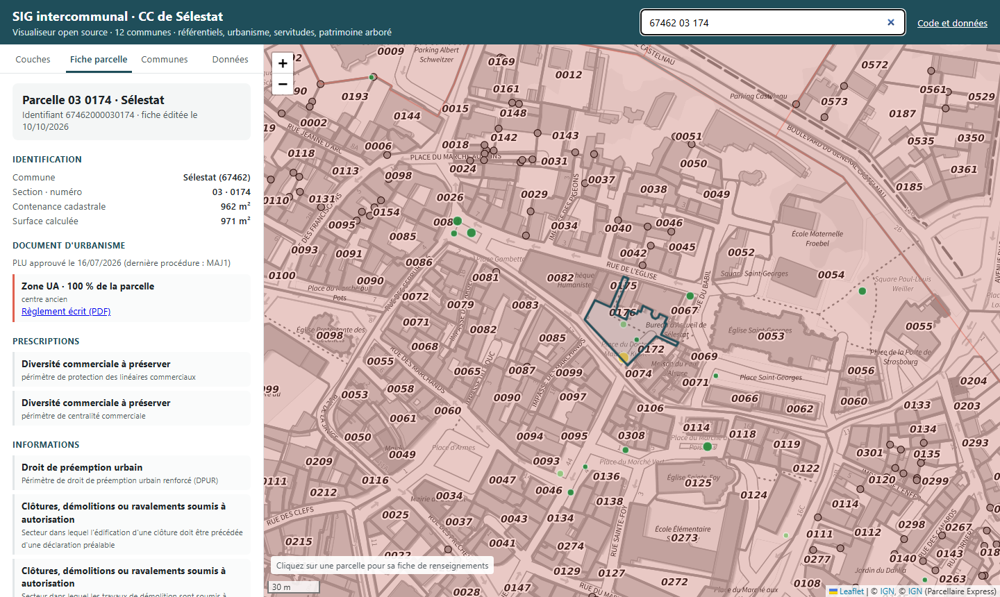
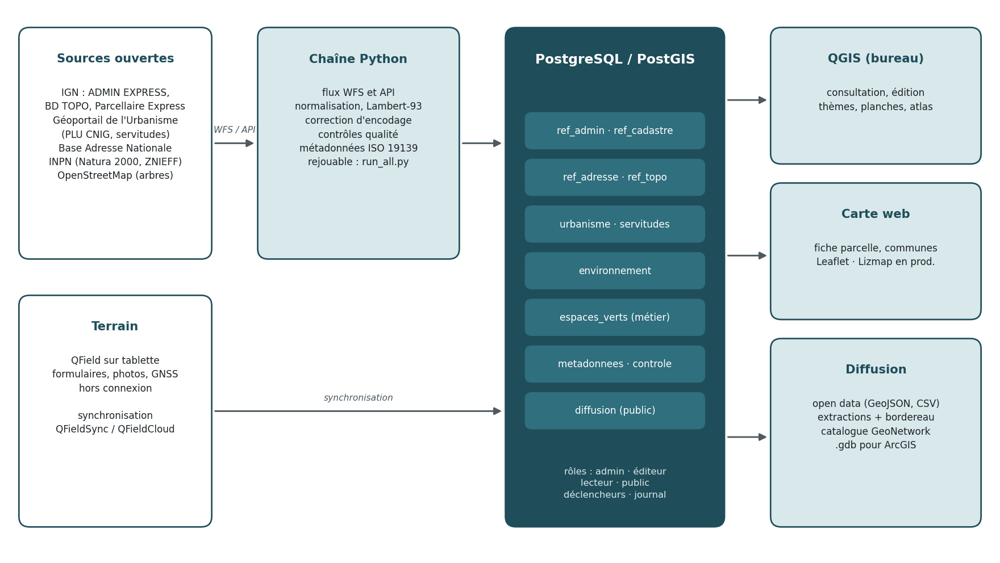
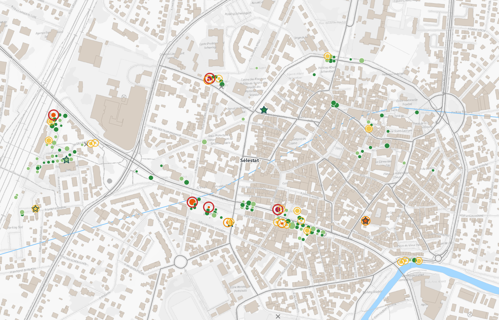
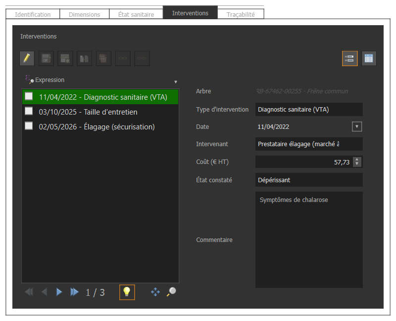
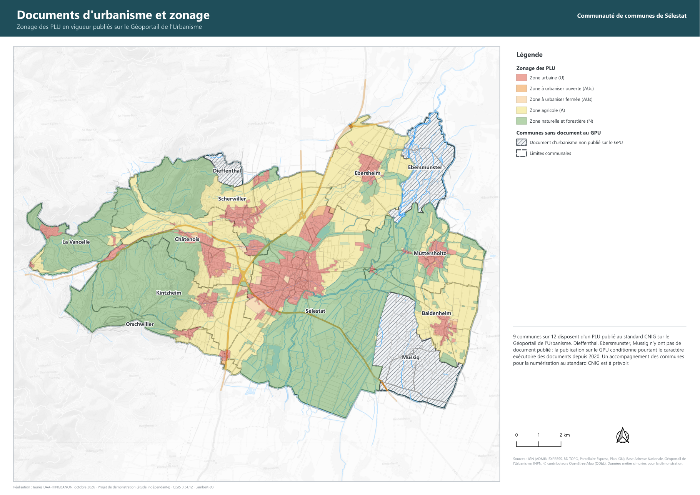
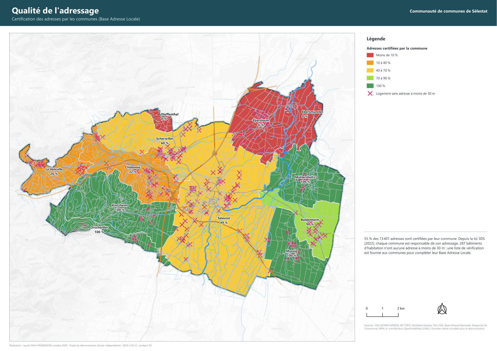
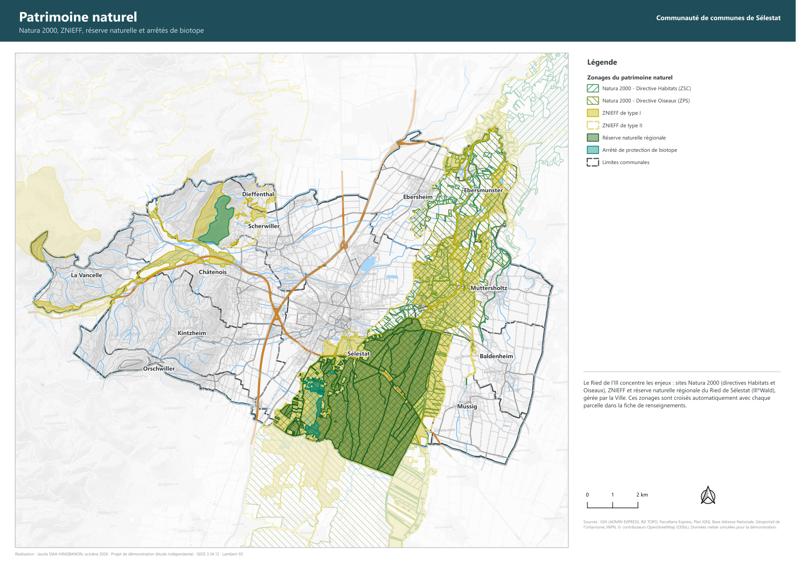
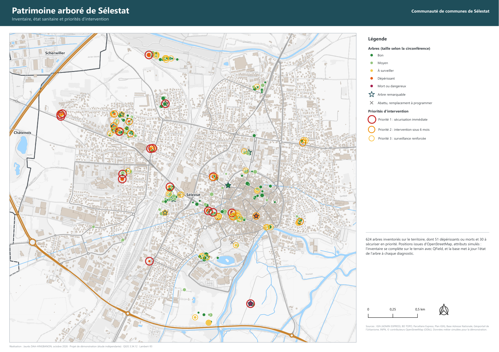

# Socle SIG intercommunal open source · CC de Sélestat

Ce projet monte de bout en bout le système d'information géographique commun d'une ville-centre et de son intercommunalité : la Ville de Sélestat et les 12 communes de la communauté de communes. Il couvre l'acquisition des référentiels, l'administration d'une base PostgreSQL/PostGIS, la saisie au bureau et sur le terrain, le contrôle qualité, la cartographie, les métadonnées et la diffusion.

Tout est fait **avec des logiciels libres** (QGIS, PostgreSQL/PostGIS, QField, Python, Leaflet) et **à partir de données ouvertes**. Le socle reste interopérable avec l'environnement ESRI : ArcGIS Pro lit PostGIS et les GeoPackage, et une géodatabase fichier est livrée pour les partenaires équipés.

> **Carte interactive :** [ouvrir la carte web](https://jauresmas.github.io/sig-selestat-territoires/) (fiche de renseignements par parcelle, indicateurs communaux, catalogue)
> **Livrables :** [`livrables/`](livrables/), avec le [bordereau de livraison](livrables/01_Documents/00_Bordereau_de_livraison.pdf) et la [note d'architecture](livrables/01_Documents/01_Note_d_architecture.pdf)



## Chiffres clés

| | |
|---|---|
| Territoire | 12 communes, 37 498 habitants |
| Base PostGIS | 12 schémas, 37 tables, 21 vues, 2 vues matérialisées, 4 déclencheurs, 4 rôles |
| Référentiels intégrés | 51 132 parcelles, 13 401 adresses, 30 272 bâtiments, 471 zones de PLU, 97 servitudes |
| Patrimoine arboré | 624 arbres en place, 30 essences, 824 interventions, journal d'audit complet |
| Métadonnées | 24 fiches ISO 19139 (profil INSPIRE), dictionnaire de 264 champs |
| Cartographie | 6 planches A3, atlas communal A4 (12 pages), carte web |
| Coût de licence | 0 € |

## Les missions de la fiche de poste, une par une

| Mission | Réponse dans le projet |
|---|---|
| Assurer le fonctionnement et le développement du SIG | Base PostGIS structurée par schémas, rôles et droits par défaut ; chaîne de traitement rejouable ([`run_all.py`](scripts/run_all.py)) |
| Numériser et intégrer les données | Flux WFS de l'IGN, API du Géoportail de l'Urbanisme, INPN, BAN ([`00_acquisition.py`](scripts/00_acquisition.py)) ; modèle métier saisi au bureau ou avec QField |
| Paramétrer le logiciel de consultation | Projets QGIS par thèmes, formulaires de saisie, carte web avec fiche parcelle |
| Cartographier, partager, valoriser | Planches A3 et atlas générés par QGIS, carte web publique, jeux open data |
| Respecter et faire respecter la diffusion | [Charte de diffusion](livrables/01_Documents/02_Charte_de_diffusion.pdf), niveaux par jeu, [outil d'extraction](scripts/extraction.py) avec bordereau, registre des diffusions |
| Conseiller et accompagner les utilisateurs | [Fiches tutoriel](livrables/01_Documents/03_Fiches_tutoriel.pdf) QGIS, QField et carte web |

## Architecture



| Usage | Environnement ESRI | Équivalent libre utilisé ici |
|---|---|---|
| SIG bureautique | ArcGIS Pro | QGIS 3.34 LTR |
| Base d'entreprise | Géodatabase d'entreprise | PostgreSQL 15 / PostGIS 3.5, pgAdmin |
| Domaines, règles attributaires | Domains, Attribute rules | Tables de listes de valeurs, déclencheurs PL/pgSQL, contraintes de formulaire |
| Suivi des modifications | Editor tracking | Colonnes auteur/date et journal d'audit (avant/après en JSON) |
| Collecte terrain | Field Maps | QField (QFieldSync ou QFieldCloud) |
| Application web | Experience Builder, Web AppBuilder | Carte web Leaflet (démo) ; Lizmap / QGIS Server en production |
| Modules métier | Arcopole Builder | Fiche parcelle PostGIS, extension Cadastre de QGIS |
| Mises en page | Layouts, map series | Mises en page et atlas QGIS |
| Échange | Géodatabase fichier | GeoPackage ; `.gdb` écrite par GDAL (OpenFileGDB) |

## La base PostgreSQL/PostGIS

Il y a un schéma par famille de données : `ref_admin`, `ref_cadastre`, `ref_adresse`, `ref_topo`, `urbanisme`, `servitudes`, `environnement`, `espaces_verts`, `metadonnees`, `controle`, `diffusion` et `import`. Les droits sont donnés par bloc à quatre rôles (`sig_admin`, `sig_editeur`, `sig_lecteur`, `sig_public`), y compris sur les tables créées plus tard. Aucun mot de passe n'apparaît dans les scripts ni dans les projets : QGIS se connecte par un [service](qgis/pg_service.conf).

Les scripts SQL sont dans [`sql/`](sql/) et se lisent dans l'ordre :

| Script | Contenu |
|---|---|
| [`01_structure.sql`](sql/01_structure.sql) | Extensions, rôles, schémas, droits par défaut, catalogue, registres |
| [`02_referentiels.sql`](sql/02_referentiels.sql) | Clés étrangères, index, recherche d'adresse tolérante aux fautes, nomenclatures CNIG et SUP |
| [`03_espaces_verts.sql`](sql/03_espaces_verts.sql) | Modèle métier : arbres, interventions, listes de valeurs, déclencheurs, journal, vues de priorités |
| [`04_urbanisme.sql`](sql/04_urbanisme.sql) | Zonage dominant par parcelle, fonction `fiche_parcelle` |
| [`05_controles.sql`](sql/05_controles.sql) | Huit vues de contrôle qualité, une ligne par anomalie |
| [`06_diffusion.sql`](sql/06_diffusion.sql) | Vues publiables, sans donnée interne |
| [`07_indicateurs.sql`](sql/07_indicateurs.sql) | Indicateurs par commune (vue matérialisée) |

Une seule requête suffit pour obtenir la fiche de renseignements d'une parcelle :

```sql
SELECT urbanisme.fiche_parcelle('67462000030174');
-- zone UA (centre ancien) avec le lien vers le règlement, abords de monuments historiques (PDA Centre),
-- site inscrit, droit de préemption urbain renforcé, centralité commerciale, 3 arbres inventoriés...
```

## Contrôle qualité : ce que les données révèlent

| Contrôle | Anomalies |
|---|---|
| Géométries invalides | 0 |
| Chevauchements de zones dans un même PLU | 2 (dont 1,6 ha à Ebersheim) |
| Parcelles couvertes à moins de 50 % par le zonage | 21 |
| Adresses non certifiées par la commune | 6 039 (55 % des adresses sont certifiées) |
| Bâtiments d'habitation sans adresse à moins de 30 m | 287 |
| Arbres en doublon · fiches incomplètes | 1 · 29 |

Trois communes (Dieffenthal, Ebersmunster et Mussig) n'ont aucun document d'urbanisme publié sur le Géoportail de l'Urbanisme. Deux défauts des sources ont aussi été corrigés à l'intégration : des libellés de servitudes encodés deux fois en UTF-8, et l'absence de lien vers les règlements écrits. Le [classeur de contrôle](livrables/08_Tableaux/controle_qualite_et_indicateurs.xlsx) détaille chaque anomalie avec l'action corrective attendue.

## Patrimoine arboré : du bureau au terrain

Le modèle métier est conçu pour la saisie hors connexion. Chaque arbre a un identifiant UUID, et la base lui attribue un numéro lisible (`ARB-67462-00123`), déduit sa commune de sa position, refuse un point hors du territoire et journalise chaque modification. Une intervention met à jour la fiche de l'arbre : un diagnostic actualise son état, un abattage le retire de l'inventaire en place. Les positions viennent d'OpenStreetMap ; les attributs sont simulés de façon reproductible pour la démonstration.

Le projet [QField](livrables/03_Projets_QGIS/qfield/) reprend les formulaires du bureau (onglets, listes déroulantes, contrôles, photo). La commune est calculée hors connexion par expression, la précision GNSS et l'auteur sont enregistrés automatiquement.

Les saisies reviennent dans la base de deux façons :

| Projet emporté sur le terrain | Retour vers PostGIS |
|---|---|
| Préparé par l'extension QFieldSync depuis `qgis/sig_ccst_postgis.qgz` (couches déjà réglées : arbres et interventions hors connexion, repères copiés, fonds IGN en ligne) | « Synchroniser depuis QField » dans QGIS, ou QFieldCloud |
| Dossier `qfield/` livré, autonome sur GeoPackage | [`import_terrain.py`](scripts/import_terrain.py) : nouveaux arbres et interventions ajoutés, modifications appliquées (la plus récente l'emporte), photos copiées, refus listés, rien de supprimé |

```bash
python scripts/import_terrain.py D:/retour/inventaire_arbres.gpkg --simulation   # rapport sans rien écrire
python scripts/import_terrain.py D:/retour/inventaire_arbres.gpkg
```

<p>


</p>

## Cartographie

Les planches et l'atlas sont des mises en page du projet QGIS : ils se régénèrent à chaque mise à jour.

<p>


</p>
<p>


</p>

## Métadonnées et diffusion

Chaque jeu a une fiche dans `metadonnees.fiche` : titre, résumé, thème INSPIRE, producteur, licence, millésime et **niveau de diffusion** (ouverte, interne ou restreinte). Les fiches [ISO 19139](livrables/05_Metadonnees/iso19139/) en sont tirées. Elles peuvent être moissonnées par un catalogue GeoNetwork et alimentent aussi les métadonnées des couches QGIS et le catalogue de la carte web.

L'outil d'extraction applique la charte au moment de la remise :

```bash
python scripts/extraction.py --demandeur "Bureau d'études (exemple)" --objet "Étude de requalification" \
    --communes 67073 --jeux zone_urba prescription_surf sup_assiette_s zonage_naturel arbre intervention
# interventions : refusé (jeu interne) ; arbres : version publique livrée ; bordereau PDF + registre
```

## Livrables

| Dossier | Contenu |
|---|---|
| `01_Documents/` | Bordereau de livraison, note d'architecture, charte de diffusion, fiches tutoriel |
| `02_Base_PostGIS/` | Sauvegarde complète (`pg_restore`) et structure SQL |
| `03_Projets_QGIS/` | Projet de consultation sur GeoPackage, projet QField et son GeoPackage |
| `04_Echanges/` | Géodatabase fichier pour ArcGIS, jeux open data (GeoJSON, CSV) |
| `05_Metadonnees/` | Fiches ISO 19139, catalogue, dictionnaire des données |
| `06_Cartes/` | 6 planches A3 (PDF et PNG) |
| `07_Atlas_communal/` | Atlas A4, une page par commune |
| `08_Tableaux/` | Contrôles qualité détaillés et indicateurs communaux (Excel) |
| `09_Diffusion/` | Exemple d'extraction pour un tiers, avec bordereau de diffusion |

Le projet de production connecté à PostGIS est dans [`qgis/sig_ccst_postgis.qgz`](qgis/).

## Reproduire

Prérequis : Python 3.10 ou plus récent, PostgreSQL 15 avec PostGIS, QGIS 3.34 LTR. Les chemins des binaires sont dans [`scripts/config.py`](scripts/config.py).

```bash
python -m venv .venv
.venv\Scripts\activate
pip install -r requirements.txt
playwright install chromium        # captures de la carte web
python scripts/run_all.py          # une dizaine de minutes
```

La chaîne crée une instance PostgreSQL de démonstration (`data/pgdata`, port 5433) pour ne pas toucher à une instance existante. Pour **mettre à jour**, il suffit de relancer `run_all.py` : les flux renvoient toujours le dernier millésime publié. Pour **transposer** à un autre EPCI, changez `EPCI_SIREN`, `EPCI_NOM` et `DEPARTEMENT` dans `config.py`.

## Sources et licences

Sources : IGN (ADMIN EXPRESS COG, BD TOPO, Parcellaire Express, Plan IGN, photographies aériennes) · Base Adresse Nationale · Géoportail de l'Urbanisme (PLU au standard CNIG, servitudes d'utilité publique) · INPN / PatriNat · © contributeurs OpenStreetMap.

Les référentiels sont sous [Licence Ouverte 2.0](https://www.etalab.gouv.fr/licence-ouverte-open-licence/). L'inventaire arboré, dérivé d'OpenStreetMap, est sous [ODbL](https://opendatacommons.org/licenses/odbl/). Le code est sous licence [MIT](LICENSE).

## Statut

Ce projet personnel a été réalisé à titre de démonstration, à partir de données ouvertes. C'est une **étude indépendante** : elle n'engage ni la Ville de Sélestat ni la communauté de communes. Les attributs du patrimoine arboré (dimensions, état, interventions) sont simulés.

Réalisation : Jaurès DAA-HINGBANON · octobre 2026
